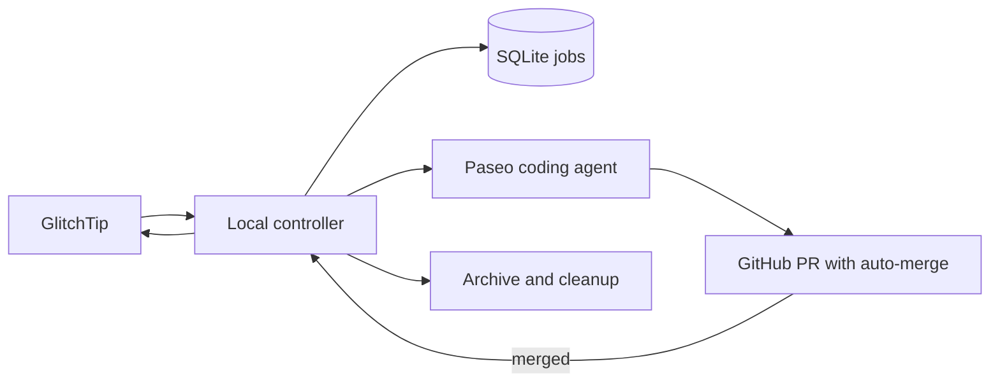

# Add Simple GlitchTip-to-Paseo Remediation

## Summary

Replace the ledger-heavy remediation design with a small local controller. It records one durable job per eligible GlitchTip activation, asks a Paseo coding agent to open an auto-merge PR, and resolves/cleans up only after GitHub confirms the merge.

---

## Problem Frame

The original design duplicates GitHub’s policy, requires several credentials and agent roles, and turns a small automation into a large orchestration system. GitHub already protects `main` with required CI, so the controller should observe that server-enforced outcome instead of attempting independent approval and merge decisions.

---

## Scope Boundaries

- GitHub-required CI is the sole merge gate; there is no independent review agent or controller merge gate.
- The coding agent and controller share one GitHub automation credential that cannot bypass branch protection.
- Failed jobs never retry or rebase automatically.
- The controller remains local and outside the production application and Docker deployment.
- Replacement monitoring covers only Ignite GlitchTip projects 1 and 2; other repositories are legacy-cleanup targets only.
- Do not add webhooks, public endpoints, or general issue triage.

### Deferred to Follow-Up Work

- Separate credentials, independent review, custom check/status gates, and exact-head review attestations.
- More sophisticated event history or action-ledger recovery beyond the simple durable job record.

---

## Relevant Code and Patterns

- `automation/glitchtip-paseo-controller/` is the current Python 3.12 package. Retain its locked tooling, safe configuration, typed clients, and fixture approach while deleting/replacing unneeded ledger abstractions.
- `scripts/glitchtip` defines the GlitchTip deployment, organization, projects, issue detail/latest-event endpoints, and resolve operation.
- `.github/workflows/ci.yml` provides the required `backend` and `frontend` CI contexts; `infra/main.tf` enables auto-merge and protects `main`.
- `CLAUDE.md` documents Doppler and local-controller operational boundaries. The current available Doppler configuration is `prd`.

---

## Key Technical Decisions

| Decision | Rationale |
|---|---|
| One SQLite job record per issue activation | Retains restart-safe deduplication without transitions, projections, leases, or remote-action ledgers. |
| Shared GitHub automation credential | The coding agent can push/open a PR and enable auto-merge without role-specific token management. GitHub protection must remain non-bypassable. |
| GitHub auto-merge is merge authority | GitHub waits for required CI, avoiding duplicated policy parsing, review agents, and merge code. |
| Controller owns GlitchTip resolution and local cleanup | The issue only resolves after an observed GitHub merge, and the controller has the registry of active workspaces. |
| Marker-and-allowlist legacy cleanup | Automated deletion stays bounded to known legacy artifacts and stops on identity drift. |

---

## High-Level Technical Design

> *This illustrates the intended approach and is directional guidance for review, not implementation specification. The implementing agent should treat it as context, not code to reproduce.*

A job moves through only these visible states: `queued`, `working`, `awaiting_merge`, `failed`, and `complete`. The controller adopts an existing workspace or PR after restart using its stored identifiers; it does not begin a second job.

---

## Implementation Units

### U1. Simplify Configuration and Durable Job State

**Goal:** Replace the current transition/action ledger with one small job store that records issue activation, job state, Paseo workspace/agent, branch, PR, and failure reason.

**Requirements:** R1, R2, R3, R7, R8; F1, F3; AE1, AE2, AE4

**Dependencies:** Existing controller package

**Files:**
- Modify: `automation/glitchtip-paseo-controller/src/glitchtip_paseo_controller/config.py`
- Modify: `automation/glitchtip-paseo-controller/src/glitchtip_paseo_controller/state.py`
- Delete or consolidate: `automation/glitchtip-paseo-controller/src/glitchtip_paseo_controller/actions.py`
- Modify: `automation/glitchtip-paseo-controller/src/glitchtip_paseo_controller/intake.py`
- Modify: `automation/glitchtip-paseo-controller/src/glitchtip_paseo_controller/cli.py`
- Modify: `automation/glitchtip-paseo-controller/tests/test_config.py`
- Modify: `automation/glitchtip-paseo-controller/tests/test_state.py`
- Modify: `automation/glitchtip-paseo-controller/tests/test_intake.py`
- Delete or consolidate: `automation/glitchtip-paseo-controller/tests/test_actions.py`

**Approach:** Keep SQLite WAL and unique job identity, but use straightforward status updates and a single-process lock. Baseline and reactivation detection remain durable; intake records only enough issue state to decide whether a job is new. Expose concise `status`, `list`, and explicit `retry` commands.

**Execution note:** Implement the simplified state transitions test-first, including restart adoption before removing legacy code.

**Patterns to follow:** Existing U1 fixture contracts and `scripts/glitchtip` project conventions.

**Test scenarios:**
- Covers AE1. A post-baseline issue creates one queued job; repeated polls and restart retain it.
- Covers AE2. A positively resolved then newer unresolved issue creates one new job.
- An old unresolved issue remains baseline even if its latest event is recent.
- An agent/PR failure marks the job failed; only an explicit retry creates a new job.
- A corrupt database or duplicate active job fails closed without dispatch.

**Verification:** A reader can see every job’s issue, state, resources, and failure reason; no poll or restart creates duplicate work.

### U2. Run Coding Agents and Publish Auto-Merge PRs

**Goal:** Create/adopt one Paseo coding workspace for a queued job and give the agent a bounded issue brief plus the shared non-bypass GitHub credential to commit, push, open a PR, and enable auto-merge.

**Requirements:** R4, R5; F1; AE1, AE3

**Dependencies:** U1

**Files:**
- Create: `automation/glitchtip-paseo-controller/src/glitchtip_paseo_controller/remediation.py`
- Create: `automation/glitchtip-paseo-controller/src/glitchtip_paseo_controller/context.py`
- Modify: `automation/glitchtip-paseo-controller/src/glitchtip_paseo_controller/clients/github.py`
- Modify: `automation/glitchtip-paseo-controller/src/glitchtip_paseo_controller/clients/paseo.py`
- Modify: `automation/glitchtip-paseo-controller/src/glitchtip_paseo_controller/cli.py`
- Create: `automation/glitchtip-paseo-controller/tests/test_remediation.py`

**Approach:** Build bounded/redacted issue context from the current detail/latest event data. Use deterministic workspace, branch, and PR markers so restart adopts the same resources. The prompt requires issue-related changes, relevant tests, one linked PR, and auto-merge; controller reconciliation validates the linked PR rather than interpreting free-form success text.

**Test scenarios:**
- Covers AE1. A queued job launches one named Paseo workspace from current `main` and records it.
- Covers AE3. A successful agent result records one PR and requests auto-merge.
- Oversized or secret-like event fields are bounded/redacted before the prompt.
- Missing/duplicate/closed PRs and agent test failures mark the job failed without a second workspace.
- Restart adopts the stored workspace/branch/PR instead of launching another agent.

**Verification:** Every active job maps to at most one workspace, branch, and linked auto-merge PR.

### U3. Reconcile GitHub Outcome, Resolve GlitchTip, and Clean Up

**Goal:** Observe linked PRs, retain failed work, and finish only confirmed merged jobs.

**Requirements:** R6, R7, R8; F2, F3; AE3, AE4

**Dependencies:** U1, U2

**Files:**
- Create: `automation/glitchtip-paseo-controller/src/glitchtip_paseo_controller/lifecycle.py`
- Create: `automation/glitchtip-paseo-controller/src/glitchtip_paseo_controller/status.py`
- Modify: `automation/glitchtip-paseo-controller/src/glitchtip_paseo_controller/clients/github.py`
- Modify: `automation/glitchtip-paseo-controller/src/glitchtip_paseo_controller/clients/glitchtip.py`
- Modify: `automation/glitchtip-paseo-controller/src/glitchtip_paseo_controller/clients/paseo.py`
- Modify: `automation/glitchtip-paseo-controller/src/glitchtip_paseo_controller/cli.py`
- Create: `automation/glitchtip-paseo-controller/tests/test_lifecycle.py`
- Create: `automation/glitchtip-paseo-controller/tests/test_status.py`

**Approach:** Poll PR state using the stored PR identifier. A merged PR advances to GlitchTip resolution; closed, failed, or unavailable PRs fail the job and preserve evidence. Archive the agent and remove only its registered workspace/branch after a confirmed resolution. Treat uncertain remote outcomes as failed/inspectable rather than retrying automatically.

**Test scenarios:**
- Covers AE3. Confirmed merged PR resolves the current issue, archives the agent, and removes only registered resources.
- Covers AE4. Closed PR or failed CI creates a failed visible job and leaves GlitchTip unresolved.
- A timeout or unknown PR state does not resolve the issue or delete resources.
- Restart between merge observation, resolution, and cleanup completes idempotently without a new job.
- Explicit retry creates a linked fresh job; failed job stays historical.

**Verification:** GitHub’s recorded merge is the only successful transition to resolution and cleanup.

### U4. Automate Guarded Legacy Cutover and Local Operation

**Goal:** Remove identified legacy artifacts, install/document the local controller, and enable it only after cleanup and basic health checks pass.

**Requirements:** R9, R10; F4; AE5

**Dependencies:** U1, U3

**Files:**
- Create: `automation/glitchtip-paseo-controller/src/glitchtip_paseo_controller/legacy_cleanup.py`
- Create: `automation/glitchtip-paseo-controller/systemd/ignite-glitchtip-paseo-controller.service`
- Modify: `automation/glitchtip-paseo-controller/README.md`
- Modify: `automation/glitchtip-paseo-controller/config/controller.example.toml`
- Modify: `.mise.toml`
- Modify: `.github/workflows/ci.yml`
- Modify: `.gitignore`
- Modify: `README.md`
- Modify: `CLAUDE.md`
- Create: `docs/operations/glitchtip-paseo-controller.md`
- Create: `docs/operations/legacy-glitchtip-remediator-cutover.md`
- Create: `automation/glitchtip-paseo-controller/tests/test_legacy_cleanup.py`

**Approach:** Use one explicit configuration allowlist and legacy marker to inventory targets. Stop the legacy service before any deletion; delete a target only after its repository, marker, PR, branch, and local registration agree. Provide a local systemd service using Doppler `prd`, basic startup health checks, and clear observe/enable/pause/status instructions. Add a non-required controller CI job before relying on its result operationally.

**Test scenarios:**
- Covers AE5. Exact identified legacy artifacts are removed and verified absent.
- An unrelated or marker-mismatched PR/branch/path is skipped and reported.
- A remote deletion failure prevents associated local deletion and leaves cutover disabled.
- Service configuration has one local controller instance, uses XDG state, and does not inherit secrets into agent prompts/logs.
- Observe mode polls and lists eligible jobs without launching a workspace.

**Verification:** The controller is locally operable and legacy cleanup cannot broaden beyond its configured evidence.

---

## System-Wide Impact

- **GitHub:** `main` branch protection and auto-merge become the sole merge decision. The shared automation credential must not bypass protection.
- **GlitchTip:** controller reads projects 1/2 and resolves only after confirmed merged PRs.
- **Paseo:** one coding agent/workspace per job; no review agents or sidecar result protocol.
- **Local state:** SQLite records active and historical jobs only; it remains outside the repository and application deployment.
- **Operations:** legacy cleanup is automated but guarded; the controller runs as a local user service using Doppler `prd`.

---

## Dependencies / Prerequisites

- Doppler project `ignite-for-spotify`, configuration `prd`, with GlitchTip and shared GitHub automation credentials.
- GitHub auto-merge enabled and protected `main` requiring `backend` and `frontend` checks.
- Shared GitHub credential can create PRs and enable auto-merge but cannot bypass branch protection.
- Local Paseo/Pi can create workspaces and run `gpt-5.6-terra` at `xhigh`.

---

## Risks and Mitigations

| Risk | Mitigation |
|---|---|
| A bad but CI-passing fix merges | Explicitly accepted CI-only autonomy trade-off; preserve failed/merged history for operator inspection. |
| Restart duplicates work | Unique persisted job identity and deterministic workspace/PR markers. |
| Agent changes protected controls | GitHub branch protection remains non-bypassable; controller treats missing/invalid PR evidence as failure. |
| Cleanup targets unrelated work | Exact allowlist and marker match required before deletion; remote failure blocks local deletion. |
| CI changes or disappears | GitHub auto-merge remains pending/blocked; controller never resolves without recorded merge. |

---

## Deferred to Implementation

- Exact Paseo CLI/API commands for launching, inspecting, archiving, and removing registered worktrees; implementation must use the installed version’s supported interface.
- Exact GitHub API/CLI shape for requesting auto-merge with the shared credential; unsupported authorization must keep a job failed and visible.
- Exact legacy markers and paths, which must be inventoried before destructive cutover is enabled.
